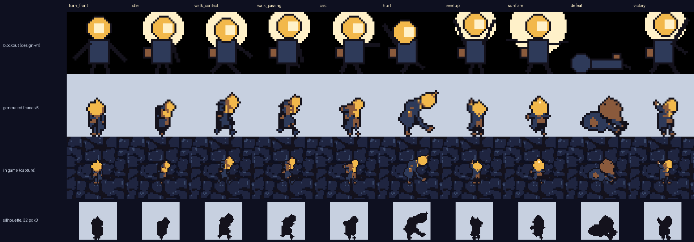

# TEST-REPORT

`walker-lanternfall-bao-x` · Bao Xing · CSYE 7270 Assignment 2

> **Status: 2026-10-02.** Source revision **`8a6f988`** (the revision the film shows; `godot/` is unchanged after it) for every automated check, capture and comparison below; engine **Godot 4.7.2.stable.official.ed1daf0bf**. My two full playtests (sound on, then muted) are in §4, with the build each was played on. The fresh clone from GitHub is done (§2). Nothing here is claimed before it was observed.

## 1. Environment

| | |
|---|---|
| Machine | MacBook, Apple M4 Pro, 16 GB, macOS 26 |
| Engine | Godot 4.7.2.stable.official.ed1daf0bf, GL Compatibility |
| Input | keyboard and gamepad bindings exist; my notes do not record a gamepad test |
| Generation / checks | Python 3.12 venvs from `gen/requirements-*.txt` |

## 2. Fresh copy

- **Local fresh clone of `1b24721`** (2026-10-01): `git clone` into an empty folder → `godot --headless --path godot --import` → all three suites: **logic 32/32, gameplay 63/63, audio 22/22**, no script errors; `audit_repo.py --stage final`: 0 problems. All 14 sprites, 7 sound effects and 2 music loops were present; nothing is downloaded at run time. (An earlier clone of `89ae6ed`, before the sounds and new props, also passed.)
- **Fresh clone from GitHub** (2026-10-02, commit `a600e65`; `godot/` identical to `8a6f988`): `git clone https://github.com/yanxlh/walker-lanternfall-bao-x.git` into an empty folder — a 63 MB checkout with no Godot cache, no file over 25 MB and no MP3/MP4 → `godot --headless --path godot --import --quit` (46 files imported, 0 errors) → **logic 32/32, gameplay 65/65 (including `generated-assets-load`), audio 25/25**, no script errors → `scripts/audit_repo.py --stage final`: 0 problems → all 23 asset files listed in `godot/assets/manifest.json` present → the game starts and runs (5 s launch, no errors in the log). Commits after `a600e65` change documents only.

## 3. Automated checks (all added for this project)

| Check | Result on `8a6f988` (re-run 2026-10-01/02) | What it proves | Evidence |
|---|---|---|---|
| `godot/tests/test_logic.gd` | 32 / 32 | state machine; branching cards, 5-level passives, damage/haste multipliers, evolution rule; XP needed always rises; SFX gate cooldowns, voice caps, once-per-run | `evidence/logic.json` |
| `godot/tests/test_gameplay.gd` | 65 / 65 | movement, diagonal normalisation, facing dead-zone, poses, nearest-enemy aim, bullets stop on visible contact, gems, level-up queue (incl. while paused), i-frames, win/lose incl. same-tick, evolution, restart, missing-art fallback, HUD text, hurtbox on the torso, HP growth, damage/haste cards, camera moves, map layout, solid props | `evidence/gameplay.json` |
| `godot/tests/test_audio.gd` | 25 / 25 (with the real sounds loaded) | once-per-event SFX, bursts, held/rapid input, music duck/filter/fade, restart during fade, mute, **sound-independence** | `evidence/audio.json` |
| `gen/checks/palette_check.py` | 14 / 14 sprites PASS | exact size, binary alpha, palette-only; enemy-vs-ground contrast | `evidence/palette-check.json` |
| `gen/checks/loop_check.py` | MUS-01, MUS-02 PASS; layer length PASS | loop wrap has no click or gap; layer = base length | `evidence/loop-check.json` |
| `gen/tile_process.py` seam metric | PASS (seam 7.52 vs interior 6.05) | the ground tile tiles without a visible seam | `evidence/tile-seam.json` |
| `scripts/audit_repo.py --stage final` | 0 problems (all 23 asset IDs present); order check PASS | no MP3/MP4/large files/caches/keys; every CHANGE-BRIEF asset exists; **every generation is newer than `design-v1`** (tag 2026-09-28 15:21 EDT; first generation commit `e384933`, 2026-09-29 16:57 EDT, a descendant of the tag) | `evidence/repo-audit.json` |
| balance probe `godot/tests/probe_balance.gd` | informational | scripted bots to compare tuning | `evidence/balance-probe-*.txt` |

The test harness fails a suite that stops early; my runner also fails on any `SCRIPT ERROR` (both added after a script error once aborted a helper silently).

Commands (from the repository root; Python checks use the venvs from `gen/requirements-*.txt`):

```
godot --headless --path godot --import --quit
godot --headless --path godot --script res://tests/test_logic.gd       # -> logic: 32 checks, 0 failures
godot --headless --path godot --script res://tests/test_gameplay.gd    # -> gameplay: 65 checks, 0 failures
godot --headless --path godot --script res://tests/test_audio.gd       # -> audio: 25 checks, 0 failures
gen/.venv-art/bin/python gen/checks/palette_check.py
gen/.venv-audio/bin/python gen/checks/loop_check.py godot/assets/music/mus_01_night_market.ogg godot/assets/music/mus_02_sunflare_layer.ogg
python3 scripts/audit_repo.py --stage final
```

The suites' full output on a fresh `git archive 8a6f988` copy is kept in `youtube/claude-liam-walker-lanternfall-bao-x-gamedev/capture/test-run-film-build-raw.txt` (122 PASS, 0 FAIL, no script errors).

## 4. My playtests

Full notes in my words: [`evidence/playtest/2026-09-29-bao-notes.md`](evidence/playtest/2026-09-29-bao-notes.md). Checklist for the final runs: [`evidence/playtest/sheet.md`](evidence/playtest/sheet.md).

| Session | Build | What I checked | Outcome |
|---|---|---|---|
| 1 — 2026-09-29, music only, no SFX yet | `40102ab` | first play of the greybox with generated art | bullets flew through monsters → loop L1 below; asked for a fuller map, rising XP cost, tougher monsters over time, more cards |
| 2 — 2026-09-29/30, music only | `79c2874` | re-test after the fixes | "子弹对的" (bullets fixed), "撞墙手感还行" (collisions feel fine), "不难" (not hard), "有合成出来" (I reached the Sunflare); asked for a more broken-up map |
| **Run A — sound on** — 2026-10-01 | `1b24721` | the full sound checklist | "只响一次，不会连起来，不会，没有空白" — each sound once, kills never machine-gun, no extra sounds from tapping/holding, no gap at the loop; pause, level-up duck, Sunflare layer, lose/win fade + stinger, R during the fade, M/9/0 all confirmed — [`evidence/playtest/2026-10-01-runs-A-B.md`](evidence/playtest/2026-10-01-runs-A-B.md) |
| **Run B — muted (M on the title screen)** — 2026-10-01 | `1b24721` | can I read every event without sound? | "第二局都能" — hits, level-ups and the evolution all readable from the picture; wraiths and the courier visible |

## 5. Movement and state changes

- Automated: `move-speed` (90 px/s), `diagonal-normalized`, `facing-left`, `facing-deadzone` (no flip for |x| ≤ 0.1), `arena-clamp`, `walk-pose` / `idle-pose` / `cast-pose-on-fire`, `levelup-opens` / `choose-card`, `levelup-queue`, `levelup-while-paused`, `death-lost`, `won-at-3min`, `death-and-timer-same-tick`, `restart-resets`, `props-block-the-courier`, `courier-slides-along-props` — all PASS.
- In play (sessions 1–2), confirmed in my notes: bullets now stop on hit, blocking props feel fine, and I reached the Sunflare evolution. Other states were not called out in the notes; Run A/B use the full checklist.

## 6. Character vs character sheet



Blockout (design-v1) · generated frame · the frame captured in the running game · generated silhouette.

**Both facings and the hurtbox, in the engine (added 2026-10-02):**


Rows: blockout · generated frame · in game facing right · in game facing left · facing left with the F3 hurtbox (r = 10 at sprite origin (16, 23)). Captured on an isolated copy of `8a6f988` by `scripts/capture_facing.gd` (same seed and setup as `godot/tests/capture.gd`; screens `evidence/screens/pose-*-left*.png`). Facing left is the code's mirror of the right-facing frame for every pose, as the sheet specifies. Mismatches with the collision shape, pose by pose: in the standing poses (turn_front, idle, walk, cast, levelup, sunflare, victory) the circle covers the coat and also the lower half of the lamp; in **hurt** the lamp leans back outside the circle (in the courier's favour); in **defeat** the body lies partly outside it, which does not matter because the run has ended. Held: 32 × 32, palette-only, binary alpha, feet on row 31, lamp normalised to 12 px, right-facing master with code flip. Broke and fixed: the generated courier is shorter, so the torso sat 1.7–3.6 px below the hurtbox centre → sprite origin moved to (16, 23) (loop L8). Still open: an r = 10 hurtbox now also covers the lower lamp; silhouettes are less distinct than the blockout (levelup vs victory). Details: CHARACTER-SHEET R2–R3.

## 7. Storyboard vs game


All nine panels were captured from the build (`godot/tests/capture.gd`). The first comparison showed none of the camera moves; they were then implemented (title push-in, hit tilt, Sunflare zoom-out, fog lifting at 3:00) and re-captured (STORYBOARD R1–R2). Remaining differences: the courier is far smaller on screen than drawn, and the fog-wraith is nearly invisible on the cobbles in P5.

## 8. Sound: once per event

Automated (the gate and the counts do not depend on the audio files; re-run with the real sounds loaded). Numbers are from the final build `8a6f988` (`evidence/audio.json`); the review fix that keeps spawns off-screen changed how seed 11 plays out, so builds before it reported 88 kills → 88 plays (min gap 117 ms), 73 pickups → 54 plays and an independence end state at tick 3850. The verdicts did not change.

| Check | Observed |
|---|---|
| `once-levelup` | one chime per card screen over a full run (count compared with card screens opened) |
| `once-hurt` | 14 hits → 14 plays (one per i-frame window) |
| `kill-throttled` | 80 kills → 78 plays, never closer than 60 ms (min gap 184 ms) |
| `pickup-merged` | 68 pickups → 50 plays (pickups within one 300 ms voice slot merge — CHANGE-BRIEF R6) |
| `burst-20-kills-one-sfx` | 20 kills in one tick → 1 play |
| `evolve-sfx-once` / `one-stinger` | 1 evolution sound; 1 stinger at the end |

**Run A (me):** each of the seven sounds played once on its event — "只响一次" — and kills in dense waves did not run together — "不会连起来".

## 9. Rapid and held input

Automated: `hold-input-no-sfx` (100 ticks holding a direction → 0 sounds), `rapid-pause-no-sfx` (20 pause toggles → 0 sounds, state correct) — PASS. Key presses ignore key-repeat echo, and no sound is attached to input. **Run A (me):** tapping fast and holding a direction produced no extra sounds — "不会".

## 10. Music loop seam

| Loop | Length | Wrap jump vs p99 step | Head / tail RMS vs mean | Result |
|---|---|---|---|---|
| MUS-01 night market | 20.004 s | 0.00104 vs 0.00917 | 1.28 / 0.50 | PASS |
| MUS-02 Sunflare layer | 20.004 s | 0.00844 vs 0.02508 | 1.74 / 2.29 | PASS |
| layer length = base length | 882176 = 882176 frames | — | — | PASS |

By ear: I listened to each of the four MUS-01 candidates as a loop played three times in a row and picked the one without audible clutter; I listened to three MUS-01 + MUS-02 mixes looped three times and picked s34. **Run A (me):** no click or gap at the loop point in the game — "没有空白".

## 11. Pause and end behaviour

Automated: `pause-lowpass-and-duck` (low-pass on, −10 dB), `resume-restores`, `levelup-duck` / `levelup-unduck` (−6 dB), `lost-fades` → `lost-stops`, `restart-during-fade` (new run's music at full volume, filter off), `restart-from-pause`, `mute-flags`, `mute-no-state-change` — PASS. `independence`: a seeded run with every stream removed and the master bus muted ends in exactly the same state as the run with sound (same tick 3817, kills 80, level 7, position −220.11, 202.53 — build `8a6f988`). **Run A (me):** confirmed in play — pause muffles and quietens the music and resume restores it; level-up dips it; the Sunflare layer comes in; lose/win fade with the stinger; R during the fade restarts the music cleanly; M/9/0 work.

## 12. Understandable without sound

Design: every sound event has a visual — hit: red flash, screen tint, knockback, HP bar; pickup: the gem flies to the courier and the XP bar/number rises; level-up: the field freezes and cards appear; evolution: banner, zoom-out, brighter courier; end: result panel; the HUD shows `MUSIC on/off SFX on/off`. **Run B (me), muted from the title screen:** "第二局都能" — I could tell being hit, levelling up and evolving without sound, and I could see the fog-wraiths and the courier. Measured contrast for the wraith is still the lowest (0.03), but in play it read well enough, so its colours stay as generated.

## 13. Observe → change → re-verify

| # | Observed (by) | Change | Re-verified (how) |
|---|---|---|---|
| L1 | Bullets flew on through monsters — **me, in play** | Weapons hit the visible sprite box (moth wing 11 px, wraith hood 19 px, was 6 / 14) and the bolt is a segment | `beam-stops-on-moth-wing`, `beam-stops-on-wraith-hood` RED → GREEN, control `beam-misses-when-clear-of-sprite`; **me, in play: "子弹对的"** |
| L2 | First character images looked like a shaded 3D illustration — **me** | **Prompt** rewritten for 16-bit pixel art; 10 poses | new batch reviewed at game size; I accepted 10 frames |
| L3 | Reduced to 32 px, the navy coat turned black and the floor shadow cream — preview | **Palette** matching moved to Lab, ink reserved for outlines, grey shadows keyed out | preview re-checked; `palette_check.py` PASS |
| L4 | The lamp changed size from pose to pose at 32 px — review sheet | Frames scaled so the lamp is 12 px (sheet rule 11–13) | measured 12.0 px on all 10 frames |
| L5 | Two ground tiles failed the seam check; all were noisy at 64 px — seam metric | Centre 40 % crop before tiling; took the passing candidate | seam 7.52 vs interior 6.05 PASS |
| L6 | Three MUS-01 loops were "太乱了，杂音太多" — **me, listening** | MUS-02 **prompt** rewritten without shakers/tambourine | I listened to the new mixes and chose one |
| L7 | First MUS-02 layers were ~106 BPM or hiss — loop check | Model changed (melody → medium); **loop point** cut on the same 8 bars and stretched ≤ 10 % | `layer-length-match` PASS; stretch 0.9897 |
| L8 | Coat centre 1.7–3.6 px below the hurtbox centre — measurement | Sprite origin (16, 20) → (16, 23) | `hurtbox-centred-on-torso` RED → GREEN |
| L9 | Smooth HP growth made moths need two hits from the first second; bots died in 36–84 s — probe | Growth stepped per whole minute | gem-collecting bot evolved at ~1:30 and won 2 of 3; **me, in play: "不难", "有合成出来"** |
| L10 | First puddle batch: the prompt's "on dark cobblestones" made FLUX paint the stones, keying failed, the puddle became a blob — review sheet | Puddle **prompt** rewritten: isolated on white, no ground | second batch keyed cleanly; I accepted s37 (gold reflection survives at 32×16) |
| L11 | In the in-game preview the leaves were brighter than the courier's body and the puddles lighter than the ground — street capture | Decals drawn at 55 % opacity (`DECAL_ALPHA`) | `decals-are-subtle`; map overview re-captured; I approved |
| L12 | A fresh clone run by double-clicking the launcher showed placeholder art and no sound (no import cache) — **whole-branch code review** | Launcher imports on first run; new check `generated-assets-load` | ran the launcher in a brand-new clone: 46 files imported, 0 load errors; the check fails in an unimported clone and passes after |
| L13 | Two levels from one pickup played two stacked level-up chimes and a silent second card screen — code review | SFX-04 moved to the card screen opening | `levelup-sfx-on-card-screen` RED ([0,0] vs screens at [1,2]) → GREEN |
| L14 | Near walls and corners enemies could spawn on screen, even on the courier — code review | Spawn outside the view rectangle (seeded re-roll, then the widest off-screen strip) | `spawns-arrive-off-screen` RED (83/200 visible) → GREEN (0/200) |

## 14. CHANGE-BRIEF predictions, scored

| # | Prediction | What happened |
|---|---|---|
| 1 | Kill SFX machine-guns in dense waves | Did not happen: min gap 184 ms and 20 kills → 1 sound in the automated runs (8a6f988); by ear in Run A, "不会连起来". |
| 2 | Generated poses drift after downscaling | Happened, differently than predicted: identity held, but FLUX ignored the pose grid and the lamp size varied; fixed by per-pose prompts and lamp normalisation (L2–L4). |
| 3 | MusicGen loops click or drift | Did not happen after processing: all loops PASS; confirmed by ear on the candidates. |
| 4 | Enemies unreadable against the ground | Measured low for the wraith (contrast 0.03 vs 0.40 for the moth), but in my muted run it was readable ("第二局都能"); kept. The props added later were made subtle (decals at 55 %) so the ground stays darkest. |
| 5 | MUS-02 drifts against MUS-01 | Happened with the melody-conditioned model; fixed with a second batch (L7). |

## 15. Code review

A fresh-context reviewer read the whole branch (Godot code, tests, pipeline, checks), ran every suite in an imported and an unimported clone, and probed the five Review Focus cases plus the engine's mixed audio across the loop point (sample-identical to the file). Verdict: ready with fixes. Fixed: L12–L14 above, plus restart silencing the lose/win stinger (`restart-silences-stingers`) and the missing-art check now rendering frames and comparing runs (`missing-art-same-run-and-draws`). Deferred (minor): the left stick can skip several cards on the card screen (gamepad untested); placeholder shapes do not match the hit/solid boxes; two checks are weaker than their names (`enemies-pass-through-props`, and the full-run audio comparison ends before an evolution).

## 16. Open questions and not yet verified

- Hurtbox kept at r = 10 (it reaches the lower lamp); it was not raised as a problem in play.
- The courier is small on screen (~20 px tall); readable in both runs, but worth revisiting if the camera ever zooms out further.
- No gamepad test is recorded.
- Balance is tuned against my own play and scripted bots only.


## Particle effects — 29 October 2026

This section records the new automated runs separately from the earlier Assignment 2 report. The starting local course-repository snapshot was `9fa5d88`; design and wrapper were recorded at `8eb16a2`, and initial project context at `a46c055`. No local `a5` tag or earlier shader directory was found. This is not a claim that the missing assignment has been completed.

Engine: Godot 4.7.2.stable.official.ed1daf0bf. Project renderer: GL Compatibility. Checks below ran headlessly with a dummy renderer and establish no visual quality or GPU cost.

### Existing-suite baseline

| Suite | Mode | Checks | Failures | Result |
|---|---|---:|---:|---|
| logic | 60 fps | 32 | 0 | `evidence/assignment-6/baseline/logic.json` |
| gameplay | 60 fps | 65 | 0 | `evidence/assignment-6/baseline/gameplay.json` |
| audio | realtime | 25 | 0 | `evidence/assignment-6/baseline/audio.json` |

Earlier `evidence/logic.json`, `gameplay.json`, and `audio.json` were preserved byte-for-byte. Baseline logs are alongside the JSON files above. Existing gameplay tests report resource/ObjectDB cleanup warnings; they still reach the suite end with all 65 assertions passing. The environment also reports a macOS certificate-store warning; this is not a shader or script error.

### Effect A configuration

`./scripts/run-test.sh test_defeat_sparks_config.gd 60`: 39 checks, 0 failures. Result: `evidence/defeat_sparks_config.json`; output: `logs/test_defeat_sparks_config_60fps.log`. The test checks the real instantiated scene, all brief parameters, scale and colour resources, the generated texture, and additive draw material.

| Mutation | Actual outcome | Evidence |
|---|---|---|
| Rename `initial_velocity_min` to `initial_velocity` | Exit 1; loaded minimum became 0 instead of 25 | `evidence/assignment-6/mutations/godot3-name.log` |
| Change spread 180 to 90 without updating the brief | Exit 1; spread read-back failed | `evidence/assignment-6/mutations/wrong-value.log` |

The scene was restored after each mutation. Its final configuration run passes again.

Windowed check of the old-name mutation, repeated on 29 October 2026 against the kept r1 scene: Godot loaded the renamed property without a warning and used 0 for `initial_velocity_min`. The burst still appeared with the same colours and fade timing, but spread about 10–15% tighter, with a few sparks lingering near the centre (e.g. 45 × 43 → 40 × 42 px at 0.20 s). The configuration test failed only on that setting. The scene was restored byte-identical and the test passed again (39/0). Frames, sheet and log: `captures/defeat_sparks/mutation-godot3-name/`.

### Preview smoke check

A headless run of `res://previews/defeat_sparks_preview.tscn` at 30 fps with `--retrigger` completed 60 frames and printed trigger events at frames 10 and 13. This checks that the fixture loads and schedules both events. It does not prove visible particles, independent burst appearance, or correct gameplay integration.

### Checks recorded later

The dated sections below record, in order: gameplay integration and the real-input state test; the visibility trial and the portrait anchor; the trail comparison; Effect A's r1 revision; the windowed play checks and edge suite; CPU and GPU cost; and the generated process shader. The brief coverage table is in the play-check section. Still open: the film, the final regression at the submission tag, and fresh-clone verification.


### Approved hit and upgrade integration — 29 October 2026

The design revision was recorded before implementation at `ec024c5`. Effect A now responds to `Session.weapon_hit`, emitted for each living enemy passed to the existing `damage()` method. It includes lethal and nonlethal hits. The historical `defeat_sparks` scene filename is retained; the new listener does not subscribe to `enemy_killed`, avoiding a double burst on lethal hits. A separate celebration follows `leveled_up`; B is the movement trail.

The session changes only add a signal publication and attach a presentation child. Damage arithmetic, collision queries, weapons, state transitions, input, and timing are unchanged.

Configuration runs at 60 fps: A 39/39; trail and celebration 78/78. Real-input state suite at 60 fps: 31/31 (`evidence/particles_state.json`, `logs/test_particles_state_60fps.log`). The suite starts with Enter, moves with D, pauses with P, chooses a card with 1, and restarts with R through parsed keyboard events and the actual physics loop. Enemies and pickups are seeded as fixtures; it never calls the damage or particle trigger functions.

Observed state evidence includes three beam hits within one particle lifetime, separate instances for lethal and nonlethal hits, positions matching the real hit signal, bursts surviving enemy removal, movement/idle/hidden/pause policies, celebration playback during LEVELUP, and restart cleanup. A stress fixture produced 40 hit events and 32 accepted instances (512 allocated particles). A real pickup awarded six levels, creating the specified maximum of four celebration instances.

An initial state-test run failed four assertions because its first projectile had already been created before the fixture set the beam's piercing value. The fixture now seeds the world on `run_started`, before the first physics tick; gameplay was not changed to accommodate it. The failing output is retained at `evidence/assignment-6/integration/initial-state-test-failure.log`.

The new state test reports resource/ObjectDB cleanup warnings at shutdown, as the earlier gameplay suite does. These remain a test-cleanup limitation, not a claimed clean shutdown. Logs must be reviewed alongside pass counts.

These checks do not prove screen appearance, trail readability, or whether the upgrade overlay obscures the celebration. No new human verdict, frame comparison, performance measurement, or completed tuning revision is recorded.

Post-integration regression: logic 32/32 at 60 fps, gameplay 65/65 at 60 fps, audio 25/25 in realtime. Results and complete logs are under `evidence/assignment-6/integration/`; earlier result files were restored after recording the new runs. Together with A configuration (39), extra configuration (78), and state checks (31), the current recorded suites pass 270 assertions. Cleanup warnings remain as described above.

### Visibility trial r1 — 29 October 2026

The student reported that level-up sparks and the movement trail were not obvious, then approved moving celebration particles above the upgrade HUD and increasing the trail's alpha ramp. The former now uses CanvasLayer 11 with the world camera transform; the latter uses alpha 0.95/0.70/0 at normalized t=0/0.5/1. No other particle settings were changed in this trial.

Recorded post-change suites under `evidence/assignment-6/tuning/r1-tests/`: logic 32, gameplay 65, audio 25 (realtime), A configuration 39, extra configuration 79, state 33; all zero failures (273 assertions total). Added assertions verify exact overlay layer 11, ordering above HUD, and screen-space alignment with the courier. Earlier shutdown cleanup warnings persist.

Headless checks establish configuration and state only. Before/after frame strips, post-change human judgment, and a kept/reverted decision are pending; this trial is not yet counted as a completed tuning evidence cycle.

### Upgrade portrait anchor — 29 October 2026

At the student's request, celebration particles now originate at the upgrade UI portrait's torso (HUD-local 56,325), rather than the gameplay courier at screen centre. The portrait's existing rectangle was factored into a shared constant without changing its layout. Overlay layer 11 now uses the HUD transform, independently of camera movement. Particle parameters are unchanged.

Targeted verification: 34 state assertions and 65 existing gameplay assertions passed. The added camera-independence assertion confirms the burst's screen position stays with the UI when the game camera moves. Evidence is under `evidence/assignment-6/tuning/portrait-anchor/`. Shutdown cleanup warnings persist; visual judgment is pending.


Human check update: the student accepted the upgraded celebration's placement on the UI portrait after running the updated game (“可以的”). This is a placement verdict only. Before/after fixture strips, a separate movement-trail verdict, and performance measurements are not yet recorded.


### 29 October 2026 — movement trail accepted

The student explicitly confirmed that the revised movement trail is sufficiently visible. Keep the colour/alpha ramp at alpha 0.95/0.70/0 for t=0/0.5/1, with other values unchanged. This is a running-game verdict. Before/after fixture strips still need to be captured and compared; no such image evidence is claimed by this entry.


## 29 October 2026 — trail frame comparison recorded

Capture: `captures/lantern_trail/comparison-20261029-135607/`; the student ran the windowed capture and confirmed completion. Original-setting and revised-setting strips each contain frames 10,12,20,39,40,45,51,60, at 30 fps with fixed seed 7280. The baseline was re-rendered from its preserved original resource after the revision; it is not a historical pre-edit gameplay recording.

Comparison: r1 has stronger amber flecks at startup (10/12) and a clearer short trail during steady movement (20/39), with the same footprint. At stop (40) its residual sparks are brighter; by 45 both are almost gone, and at 51/60 neither leaves a trail. This supports the brightness prediction without supporting any claim of more particles or a longer lifetime. Differences are subtle at full frame and clearer in labelled magnified crops. Detailed frame reading and SHA-256 hashes are in `COMPARISON.md` and `manifest.json` alongside the captures.

The student's separate running-game verdict was to keep the visibility revision. No further setting change was made from this comparison. This supplies the missing B fixture comparison; it does not complete A's required observation-driven revision, upgrade screenshot evidence, performance measurements, shader study or film.


## 29 October 2026 — Effect A scale revision r1

The student reported no problem with the hit sparks in the integrated game. The r0 fixture strip, read against the brief, showed an initial cluster of 0.35 courier height on its first frame, below "about one character height". The approved change was `scale_amount_max` 1.2 → 1.8. The configuration expectation was edited first and failed on that setting alone (`evidence/assignment-6/tuning/a-r1-tests/defeat_sparks_config-expected-failure.log`). After the scene edit, every suite passed: logic 32, gameplay 65, audio 25, A configuration 39, extra configuration 79, state 34 (274). The r1 capture matched the prediction for first-frame size, unchanged spread and fade timing. It did not match the predicted 3–4 px wider footprint: the footprint grew about 1 px while lit area grew 1.4–1.85×. Comparison: `captures/defeat_sparks/comparison-r0-r1/COMPARISON.md`. The student kept the change after playing (“保留 更清晰了”).

## 29 October 2026 — windowed play checks and edge suite

`godot/tests/capture_play_checks.gd` ran 12 scripted scenes in a real 1280 × 720 window and saved 56 shots with per-shot effect state. It covered the celebration, hits on plain floor and the brightest props, the trail on the floor and through a light pool, pushing into a stall, restart while moving, pause, the hidden toggle, the card screen, death and victory. Readings, measurements and the items still needing human play are in `captures/play-checks/20261029-142138/PLAY-CHECKS.md`.

The new headless suite `./scripts/run-test.sh test_particles_edges.gd 60` passes 18/18 (`evidence/particles_edges.json`). It covers blocked input with zero displacement and zero emitting frames, sliding along the blocker, a one-frame position discontinuity, restart history, LOST and WON cleanup, and a clean restart from LOST. Its first run failed one fixture assertion: after sliding up, the courier was still against the stall, so moving right correctly produced no trail. The fixture was changed to walk away from the stall; presentation code was not changed.

Mutation: removing `distance > 0.01 and distance <= teleport_limit` from the trail condition in `particle_presentation.gd` made `blocked-push-never-emits` (30 emitting frames) and `jump-frame-no-emission` fail. The file was then restored byte-identical (`evidence/assignment-6/mutations/edges-no-displacement-guard.log`).

Regression after restore: edges 18, state 34, extra configuration 79, A configuration 39, logic 32, gameplay 65, audio 25 (realtime). All have zero failures, 292 assertions in total (`evidence/assignment-6/play-checks/`). Existing shutdown cleanup warnings persist.

### Brief coverage

| Brief rule | Evidence | Kind |
|---|---|---|
| A fires on every weapon hit, lethal and nonlethal, at the hit position | state: `real-beam-hits`, `nonlethal-hit-also-bursts`, `hit-event-position`, `one-instance-per-accepted-hit` | test |
| A survives enemy removal; repeats are independent; cap 32 / 512 particles | state: `lethal-hit-survives-enemy-free`, `rapid-hits-overlap`, `hit-cap-*` | test |
| A settings equal the brief (with the kept r1 value); no fixed seed in play | A configuration 39 checks; mutations `godot3-name`, `wrong-value` | test |
| A timing: compact, then spread by 0.20 s, gone by 0.45 s | r0/r1 strips: last trace 0.40 s, none from 0.43 s | frames |
| A size: about one height initially, at most two at widest | r1: 0.41 → 0.71 height in the first 0.07 s (below the initial target, recorded); widest ≤ 64 px of a 68 px limit | frames |
| A pale-yellow centre, orange dissipation; readable on dark floor and bright props | first 2 frames white from additive overlap; play checks `hit-dark`, `hit-bright-cart`, `hit-bright-post` | frames; human pending |
| A frozen outside PLAYING, cleared on terminal states and restart | state: `pause-freezes-hit`, `restart-clears-bursts`; edges: `lost-clears-hit-bursts`, `won-clears-hit-bursts`; play checks pause and card; student: pause/card/death/win/restart normal | test + frames + human |
| B emits only while PLAYING, visible and actually moving | state: `idle-no-trail`, `real-movement-starts-trail`, `hidden-stops-emission-keeps-simulation`, `upgrade-stops-freezes-trail`; edges: `blocked-*`, `slide-along-blocker-emits` | test + frames |
| B: no emission on teleport; restart leaves no line | edges: `jump-frame-no-emission`, `restart-history-at-new-origin`; play checks `restart-*`; mutation | test + frames |
| B world-space trail; gone within 0.35 s of stopping | state: `trail-world-coordinates`, `idle-stops-trail`; play checks: none at 0.20 s; B fixture comparison | test + frames |
| B dimmer and smaller than A; about 1–2 heights long | play checks: 2–4 px dim flecks vs 6–11 px sparks; visible length 26–35 px (0.8–1.0 height, low end) | frames |
| B does not hide enemies, pickups or the courier | play checks: no overlap in fixtures; student after a normal run: “没有挡住都正常” | frames + human |
| B sphere emission radius 3 and other settings | extra configuration checks | test |
| Celebration: real level-up, UI portrait, above HUD, independent of camera | state: `real-pickup-causes-levelup`, `upgrade-*`; play checks `upgrade-*`; student verdict “可以的” | test + frames + human |
| Celebration continues in LEVELUP, cap 4, cleared on restart/WON | state: `upgrade-celebration-continues-on-card-screen`, `level-cap-*`, `restart-clears-bursts`; edges: `won-clears-hit-bursts` | test |
| Effects never write gameplay state | unchanged logic/gameplay/audio counts; presentation code reads only (`particle_presentation.gd`) | test + review |
| CPU and GPU budgets | `evidence/assignment-6/cost/COST-REPORT.md`: headless CPU deltas A +0.025 ms (cycle) / +0.009 ms (32 live), B +0.004 ms, celebration +0.009 ms. GPU is unreadable on Compatibility (0 on every frame). On the Mobile/Vulkan proxy, GPU deltas are within ±0.1 ms noise. All are under budget. | measured; GPU via proxy renderer |

## 29 October 2026 — CPU and GPU cost

`godot/tests/cost_effects.gd` measured off/on pairs on identical fixtures (empty control, idle, A at its 32-burst cap, B continuous movement, celebration at its cap of 4), interleaved over 5 trials of 300 frames. Headless CPU deltas: A +0.025 ms per frame over a volley cycle, +0.009 ms with 32 live bursts, and about +0.10 ms at the p95 spawn spike; B +0.004 ms; celebration +0.009 ms. All are far under the predictions (0.8 / 0.15 / 0.25 ms) and budgets (1.0 / 0.25 / 0.4 ms).

GPU time could not be read under the project's GL Compatibility renderer on this Mac: `viewport_get_measured_render_time_gpu` returned 0 on every frame, as did Movie Maker's GPU line, and the Mobile/Metal override behaved the same. The same scenes under the Mobile renderer with Vulkan/MoltenVK, a command-line override with project settings unchanged, gave readable GPU times. Every off/on median delta (A +0.01, B −0.05, celebration +0.09 ms) was within about ±0.1 ms of run-to-run noise. This is a proxy for, not a measurement of, the shipped renderer. FPS and CPU time are not reported as GPU time. Full method, tables and limits: `evidence/assignment-6/cost/COST-REPORT.md`.

## 29 October 2026 — editor-generated particle process shader

`godot/previews/shader_study/hit_sparks_gpu.tscn` was built from the kept hit sparks with `GPUParticles2D.convert_from_particles()` (`godot/tests/build_shader_study.gd`). The student reported converting its ParticleProcessMaterial to a ShaderMaterial in the Inspector and saving the shader as `godot/shaders/particles_generated.gdshader` (379 lines, SHA-256 `2e64ebae4b965173f775951abe52f1f8f6d0eac98713cbb72c486231b83723c4`). Line 1 is the editor converter's header: “Shader automatically converted from Godot Engine 4.7.2.stable's ParticleProcessMaterial.” Only the study scene references the shader. The hashes of every file under `godot/effects/` match those recorded in `evidence/assignment-6/cost/COST-REPORT.md`, so the game's effects are unchanged.

The converted material's parameters match the CPU effect: direction (1,0,0), spread 180, initial linear velocity 25–55, gravity (0,12,0), damping 20–30, scale 0.7–1.8. It carries no `color_ramp` or `scale_curve` texture, and the study scene no longer contains the Gradient or Curve resources that `convert_from_particles()` had created. The code still samples both (lines 160–161). With them unassigned, the converted GPU copy would not reproduce the CPU effect's colour fade and shrink. This was not checked visually. The game does not use this scene.

| Item | Lines | What the code does |
|---|---|---|
| `shader_type` | 3 (`render_mode disable_velocity` on 4) | Declares a particles (process) shader, not a canvas_item draw shader |
| Uniforms from the material | 6–45 | Inspector values arrive as uniforms, e.g. `initial_linear_velocity_min/max` 10–11, `damping_min/max` 26–27, `scale_min/max` 30–31, `color_value` 42, `gravity` 43, `color_ramp` 44, `scale_curve` 45 |
| Per-particle randomness | 75–99, 227, 282 | `hash(NUMBER + 1 + RANDOM_SEED)` seeds `rand_from_seed`, so each particle draws the same random values in `start()` and every `process()` call |
| `start()` | 225–275 | Runs when a particle (re)spawns: initial colour, position and velocity |
| Emission position | 165–172, 257–260 | Point emission: position 0, then `EMISSION_TRANSFORM` |
| Initial velocity | 139, 193–201, 264, 271 | Random speed between min and max (139) times a direction within ±spread of `direction` (197–199), stored in `USERDATA1` (264), then rotated into world space (271) |
| `process()` | 277–379 | Runs every frame per live particle: age, forces, motion, colour, scale |
| Age and expiry | 293–299, 376–378 | `CUSTOM.y` advances by `DELTA / LIFETIME`; the particle deactivates past its lifetime |
| Gravity | 43, 311, 324 | `force = gravity`, added to velocity as `force * DELTA` |
| Damping | 131, 328–336 | Reduces speed by `damping * DELTA` and clamps at zero |
| Position update | 340–345 | `TRANSFORM[3].xyz += final_velocity * DELTA` |
| Colour | 42, 44, 155, 161, 248, 347, 352 | Base `color_value` multiplied by `color_ramp` sampled at normalized age (161); written to `COLOR` at spawn (248) and every frame (352) |
| Scale | 30–31, 45, 149, 160, 359–372 | Random scale between min and max (149) times `scale_curve` at normalized age (160), applied to the transform basis (364–371) |

Student explanation of the process stage and the draw stage (29 October 2026):

> The process stage decides how a particle changes. It computes each particle's speed and direction at birth, and afterwards its position, gravity, damping, colour, transparency and size. For example, the hit sparks first spread outward, then slow down, shrink and fade out; all of that belongs to the process stage.
>
> The draw stage decides what the particle looks like. It uses the texture and the draw material to show the particles computed by the process stage on screen. For example, my sparks use a small cross texture and additive blending so they look like bright points; the colour, transparency and size given by the process stage appear when they are drawn.
>
> So even if the particle motion is computed correctly, the result can still be hard to see if the texture, blend mode or draw layer is wrong.

In this project, the process side is the generated shader's `start()` and `process()` (lines 225–379), which write `TRANSFORM`, `VELOCITY` and `COLOR`. The draw side is the GPUParticles2D's `texture` (`spark.png`), its additive `CanvasItemMaterial` and its canvas layer. The level-up celebration's earlier visibility fix worked on the draw side. The particles had been on the world canvas below the upgrade HUD (layer 10); they were moved to an overlay on layer 11, and their process settings did not change.
